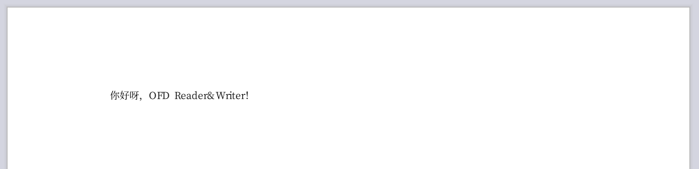

# OFD Reader & Writer 

  [](./LICENSE) 


⚠️ 在使用OFDRW前，请务必悉知 [***《OFD Reader & Writer 免责声明 / Disclaimer》***](DISCLAIMER.md)！

> 若clone和文档预览存在困难，请移步 [https://gitee.com/ofdrw/ofdrw](https://gitee.com/ofdrw/ofdrw)

**Talk is cheap,Show me the code. ——Linus Torvalds**

<p align="center">
  
</p>

OFD Reader & Writer 开源的OFD处理库，支持文档生成、数字签名、文档保护、文档合并、转换、导出等功能。

本项目采用[Apache 2.0许可](./LICENSE)，请尊重开源项目作者，在软件中附带OFDRW开源软件许可，**在遵守开源协议前提下可免费商业化使用**。

根据[《GB/T 33190-2016 电子文件存储与交换格式版式文档》](./GBT_33190-2016_电子文件存储与交换格式版式文档.pdf)标准实现版式文档OFD库（含有书签）。

项目采用Maven模块管理，各模块如下：

- [**ofdrw-core**](./ofdrw-core) OFD核心API，参考[《GB/T 33190-2016 电子文件存储与交换格式版式文档》](./GBT_33190-2016_电子文件存储与交换格式版式文档.pdf)实现的基础数据结构。
- [**ofdrw-font**](./ofdrw-font) 生成OFD字体相关。
- [**ofdrw-layout**](./ofdrw-layout) OFD布局引擎库，用于文档构建和渲染。
- [**ofdrw-pkg**](./ofdrw-pkg) OFD文件的容器，用于文档的打包。
- [**ofdrw-reader**](./ofdrw-reader) OFD文档解析器，用于OFD的反序列化以及签名签章。
- [**ofdrw-sign**](./ofdrw-sign) OFD文档数字签章。
- [**ofdrw-gm**](./ofdrw-gm) 用于支持签章模块需要的国密电子签章数据结构。
- [**ofrw-crypto**](./ofdrw-crypto) 用于实现《GM/T 0099-2020 开放版式文档密码应用技术规范》对OFD的密码相关功能。
- [**ofdrw-gv**](./ofdrw-gv) OFDRW 所有模块所共用的全局变量。
- [**ofdrw-converter**](./ofdrw-converter) OFD文档转换（格式迁移用，**不建议用于预览**，预览见下方 OFDRW 系列）。
- [**ofdrw-tool**](./ofdrw-tool) OFD文档工具，文档合并、裁剪、重组、混合。
- [**ofdrw-archive**](./ofdrw-archive) OFD-A 档案模块，依据 GB/T 42133-2022 实现 OFD 文件的合规检查和去技术化转换。***New***
- [**ofdrw-graphics2d**](./ofdrw-graphics2d) 实现了AWT Graphics2D接口，生成OFD文档内容。
- [**ofdrw-full**](./ofdrw-full) 上述所有模块整合包，用于简化依赖引入。

注：

- 您可以根据需求裁剪模块优化程序体积。
- 您可以仅引用`ofdrw-core`中定义的数据结来构建属于您自己的OFD库，就像[ofdrw-graphics2d](./ofdrw-graphics2d)那样。

## OFDRW 系列 🆕

[**ofdrw-viewer**](https://github.com/ofdrw/ofdrw-viewer) 是 OFDRW 系列项目之一，由一组可独立使用的 OFD 预览与渲染库、组件构成，为开发者补齐 OFD 处理链路的最后一环：

- [**ofdrw-viewer-ui**](https://github.com/ofdrw/ofdrw-viewer/tree/main/packages/ofdrw-viewer-ui) HTML5 OFD 阅读器组件，可嵌入业务系统实现在线预览。
- [**ofdrw-viewer-engine**](https://github.com/ofdrw/ofdrw-viewer/tree/main/packages/ofdrw-viewer-engine) 渲染引擎库，支持浏览器 / Node.js / 小程序，可绘制到 Canvas 或导出图片。
- [**ofdrw-viewer-cli**](https://github.com/ofdrw/ofdrw-viewer/tree/main/packages/ofdrw-viewer-cli) 终端图片导出工具，支持 PNG / JPEG / WebP。
- [**ofdrw-viewer-crypto**](https://github.com/ofdrw/ofdrw-viewer/tree/main/packages/ofdrw-viewer-crypto) 加密文档解密、电子印章解析与签名验证。

👉 [在线体验 https://ofdrw.github.io/ofdrw-viewer/index.html](https://ofdrw.github.io/ofdrw-viewer/index.html)

> OFDRW 负责 OFD 的生成、编辑与解析，ofdrw-viewer 负责预览与可视化，两者共同构成完整的 OFD 处理链路。**预览 OFD 无需转换**，本项目的转换模块仅用于格式迁移。

## QuickStart

Maven项目引入依赖
```xml
<dependency>
  <groupId>org.ofdrw</groupId>
  <artifactId>ofdrw-full</artifactId>
  <version>2.4.0</version>
</dependency>
```

**OFDRW 将持续保证API的向下兼容，您可以放心的升级OFDRW库至最新版本。**

> - 若您没有采用Maven管理项目，请参阅项目中`pom.xml`文件中的依赖，手动解决三方依赖包问题。
> - 若出现NoClassFound等错误，请检查相关包是否存在冲突。


如何生成一份OFD文档，如何把大象放入冰箱？


```java
public class HelloWorld {
    public static void main(String[] args) throws IOException {
        Path path = Paths.get("HelloWorld.ofd");
        try (OFDDoc ofdDoc = new OFDDoc(path)) {
            Paragraph p = new Paragraph("你好呀，OFD Reader&Writer！");
            ofdDoc.add(p);
        }
        System.out.println("生成文档位置: " + path.toAbsolutePath());
    }
}
```

效果如下：



- [文档生成API示例](./ofdrw-layout/src/test/java/org/ofdrw/layout/OFDDocTest.java)
- [文档布局示例](./ofdrw-layout/src/test/java/org/ofdrw/layout/LayoutTest.java)
- [Canvas示例](./ofdrw-layout/src/test/java/org/ofdrw/layout/element/canvas/DrawContextTest.java)
- [文字抽取示例](./ofdrw-reader/src/test/java/org/ofdrw/reader/ContentExtractorTest.java)
- [段落布局示例](./ofdrw-layout/src/test/java/org/ofdrw/layout/ParagraphLayoutDemo.java)
- [文档编辑示例](./ofdrw-layout/src/test/java/org/ofdrw/layout/DocEditDemos.java)
- [数字签名清理示例](./ofdrw-sign/src/test/java/org/ofdrw/sign/SignCleanerTest.java)

📚 相关文档目录：

- [OFD R&W 布局设计](./ofdrw-layout/doc/layout/README.md)
- [OFD R&W 扩展 自定义元素](./ofdrw-layout/doc/customelement/README.md)
- [OFD R&W 基于Canvas文档内容生成](./ofdrw-layout/doc/canvas/README.md)
- [OFD R&W 签名签章快速入门](./ofdrw-sign/doc/quickstart/README.md)
- [OFD R&W 加密 完整性保护协议](./ofdrw-crypto/README.md)
- [OFD R&W 转换OFD/OFD导出 ](./ofdrw-converter/README.md)（**不建议用于预览**）
- [OFD R&W 字形数据解析](./ofdrw-converter/src/main/java/org/ofdrw/converter/font/README.md)
- [OFD R&W 文档合并](./ofdrw-tool/README.md)
- [OFD R&W 区域占位区块（类表单效果）](./ofdrw-layout/doc/areaholderblock/README.md)
- [OFD R&W 单元格元素 使用指南](./ofdrw-layout/doc/cell/README.md)
- [OFD R&W 内容生成 事件处理](./ofdrw-layout/doc/onpage/README.md)
- [OFD R&W 附件操作](./ofdrw-layout/doc/attachment/README.md)
- [OFD R&W 添加水印](./ofdrw-layout/doc/watermark/README.md)
- [OFD R&W OFD-A 档案模块](./ofdrw-archive/README.md)

### 相关解决方案

#### HTML5

OFD 预览请优先使用 OFDRW 系列中的 [ofdrw-viewer](https://github.com/ofdrw/ofdrw-viewer)，可按需选用其阅读器组件、渲染引擎或 CLI；以下为社区其它方案（非本项目维护）：

- [DLTech21/ofd.js . https://github.com/DLTech21/ofd.js](https://github.com/DLTech21/ofd.js)
- [xxss0903/LiteOfd . https://github.com/xxss0903/liteofd](https://github.com/xxss0903/liteofd)

#### 开源阅读器


**XilouReader**：[chingliu/XilouReader . https://gitee.com/chingliu/XilouReader](https://gitee.com/chingliu/XilouReader)

- 基于pdfium的ofd/pdf双引擎版式阅读器。


**OfdiumEx**：[roy19831015/OfdiumEx . https://github.com/roy19831015/OfdiumEx](https://github.com/roy19831015/OfdiumEx)

- 基于cairo库渲染OFD。
- Windows客户端阅读器

#### 转换

> ⚠️ **不建议用转换代替预览**：字体替换、矢量图形、签章印章可能在转换中失真或丢失，加密文档无法转换。仅需查看请用 [ofdrw-viewer](https://ofdrw.github.io/ofdrw-viewer/index.html) 在线预览，仅需图片可用其 CLI 工具。

***HTML转换****

**ofd2html**：[NullYing/ofd2html-python . https://github.com/NullYing/ofd2html-python](https://github.com/NullYing/ofd2html-python)

- Python实现的OFD转换HTML


***图片转换***

推荐开源OFD图片转换解决方案： [QAQtutu/ofdbox . https://github.com/QAQtutu/ofdbox](https://github.com/QAQtutu/ofdbox)

- 支持OFD解析。
- 基于java.awt解析OFD实现图片绘制。

> 目前已经被合并到`ofdrw-converter` 模块

#### 阅读器

阅读器方面，您也可以尝试：

- [数科网维公司 . 数科OFD阅读器 . www.ofd.cn](https://www.ofd.cn/)
- [Foxit . 福昕OFD . www.foxitsoftware.cn/ofd/](https://www.foxitsoftware.cn/ofd/)

开源、可嵌入的 OFD 预览与渲染方案见 OFDRW 系列中的 [ofdrw-viewer](https://github.com/ofdrw/ofdrw-viewer)。

## 源码安装

> 支持 ***JDK 1.8*** 及以上版本构建。

在项目根目录下运行：

```bash
mvn install
```

就可以完成项目的构建打包，安装到本地Maven仓库中。

## 社区交流 💬

- 若您遇到与OFD相关的技术问题，欢迎进群交流!
- 若您对项目有建设性意见或方案欢迎提交**Issue**与**Pull Request**。

## 参与贡献 🤝

参与贡献代码尽量遵守下面代码规约：

1. **原则上禁止`public`方法、类、接口进行删除**：为了保留向下兼容性，如果是更新升级请标注过去已经暴露方法、接口、类为过时标记`@Deprecated`，并注释置新的实现位置`@deprecated {@link SomethingNew}`。
2. **请为每个`public`方法、类、接口添加注释**：为了保留开发者的便利性，注释一般为多行注释，注释内容需要包含参数以及方法或类的作用、参数意义、返还值以及意义、异常抛出、以及参数意义。

[>> GitHub 第一次参与开源(多语言)](https://github.com/firstcontributions/first-contributions)

> - [贡献指南](CONTRIBUTING.md)。

## 项目情况

### 进展

[>> 项目进展](releasenotes.md)

> 在OFDRW 2.0.0之后，项目进展以发布说明的方式在项目托管仓库中描述。
